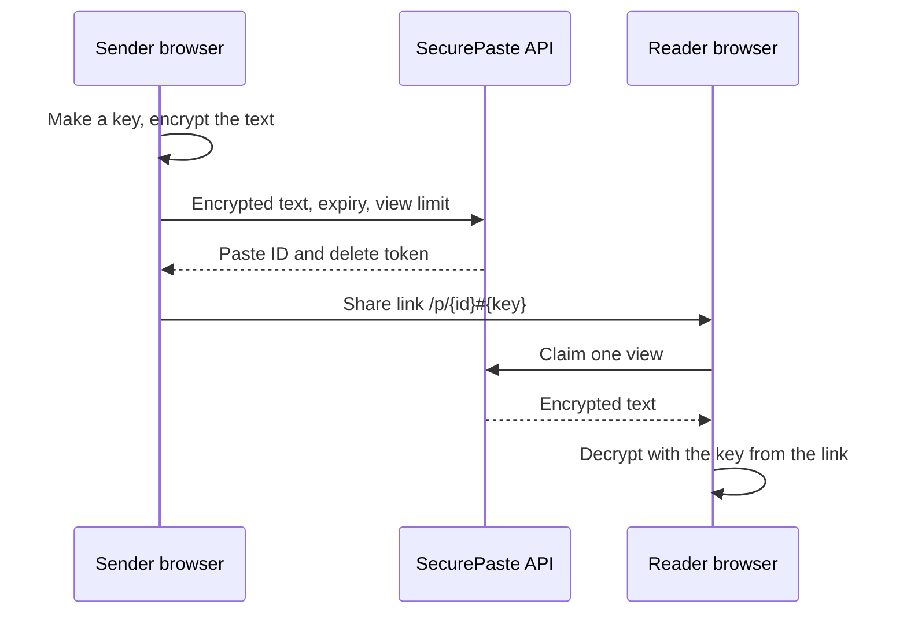

# SecurePaste

Share text or code through a link that expires. Your browser encrypts the
text before it leaves, and the key lives only in the link, so the server
stores data it cannot read.

## How it works

1. You paste text, then choose when it expires (15 minutes, 1 hour, 1 day or
   7 days) and how many times it can be read: once, a set number of times
   (1 to 100), or any number of times until it expires.
2. Your browser makes a random 256-bit key and encrypts the text with
   AES-256-GCM (Advanced Encryption Standard in Galois/Counter Mode) through
   the browser's built-in Web Crypto API.
3. Only the encrypted text goes to the server. You get a share link like
   `/p/{id}#{key}`. Browsers never send the part after the `#` to a server,
   so the key never reaches it.
4. When someone opens the link, their browser fetches the encrypted text and
   decrypts it with the key from the link. If the paste has a view limit,
   this uses one view.
5. The paste is gone once it expires or its last view is used. You also get
   a delete link, shown once, to remove it earlier.



The server keeps the encrypted text, the expiry time, the views left and a
hash of the delete token. It never sees the text, the chosen language or
the key. The server also delivers the JavaScript that does the encryption,
so a server that sent tampered code could read pastes made after that. The
design protects against a leaked database or a curious operator.

## Built with

| Part     | Stack                                                                             |
| -------- | --------------------------------------------------------------------------------- |
| Backend  | ASP.NET Core 8, Entity Framework Core, PostgreSQL 16                              |
| Frontend | React 19, TypeScript, Vite 8, React Router 7, highlight.js, CSS modules           |
| Tests    | xUnit, Testcontainers, NetArchTest; Vitest, Testing Library, Playwright, axe-core |

The backend is a modular monolith: one app to deploy, split into modules
whose boundaries are checked by architecture tests.

## Run it locally

You need the .NET 8 SDK, Node.js 22.13+ or 24+, and Docker Desktop (for
PostgreSQL).

On Windows, run this from the repository root:

```powershell
.\dev.ps1
```

It starts PostgreSQL in Docker, applies the database migrations, installs
the frontend packages, and opens the API and the frontend in separate
terminal tabs. Then open http://localhost:5173. Flags at the top of the
script choose what runs.

On other systems, follow the manual steps in
[src/frontend/README.md](src/frontend/README.md#running-against-the-real-backend).

## Tests

Backend, from `src/backend` (Docker must be running, because the
integration tests start their own PostgreSQL container):

```bash
dotnet test
```

Frontend, from `src/frontend`:

| Command                      | What it runs                                                                |
| ---------------------------- | --------------------------------------------------------------------------- |
| `npm run check`              | type check, lint, format check, unit tests, build, size and contrast checks |
| `npm run test:e2e`           | browser tests against a mocked API, including an accessibility scan         |
| `npm run test:e2e:fullstack` | browser tests against the real API and database                             |

## Status

Version 0.1 runs locally. It is not deployed anywhere yet.

## Licence

MIT. See [LICENSE](LICENSE).
